# White VPN Client

Connect to your VPN subscription on Windows, Android, or macOS. Choose a server, check its latency, and connect from one app.

**Windows 10 and 11 (x64)** · [Download installer](https://github.com/Shuravi89/whitevpn-client-releases/releases/latest/download/WhiteVPN-windows-x64-setup.exe) · [Download portable ZIP](https://github.com/Shuravi89/whitevpn-client-releases/releases/latest/download/WhiteVPN-windows-x64.zip)

**Android 8.0 and later** · [Download universal APK](https://white-vpn.net/download/android/) · Supports ARM32, ARM64, and x86-64

**macOS 13 or later (Apple Silicon)** · [Download preview DMG](https://github.com/Shuravi89/whitevpn-client-releases/releases/download/macos-v0.7.1-preview.1/WhiteVPN-0.7.1-preview.1-macos-arm64.dmg) · [macOS release notes](https://github.com/Shuravi89/whitevpn-client-releases/releases/tag/macos-v0.7.1-preview.1)

[All releases](https://github.com/Shuravi89/whitevpn-client-releases/releases) · [Official website](https://white-vpn.net/en/)

## First connection

1. **Install White VPN Client.** On Windows, run the installer or extract the entire portable ZIP and open `whitevpn.exe`. On Android, open the downloaded APK to install it. On macOS, open the DMG and drag WhiteVPN into **Applications**.
2. **Add your subscription.** Select **Add subscription** on Windows or macOS, or tap **+** on Android, then paste your subscription link.
3. **Connect.** Choose a server and press the connection button. On Android, approve the VPN request when prompted. On macOS, approve the request to change network settings if it appears.

English is the default. To switch to Russian, open **Settings → Language / Язык** and choose **Русский**.

## Windows screenshots

White VPN Client v0.7.1-rc.5 in English with demo data. Select an image to open it at full size.

### Connection and server selection

[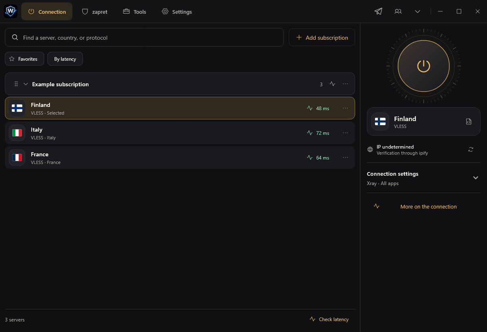](docs/screenshots/en/connection.png)

### Settings and language selector

[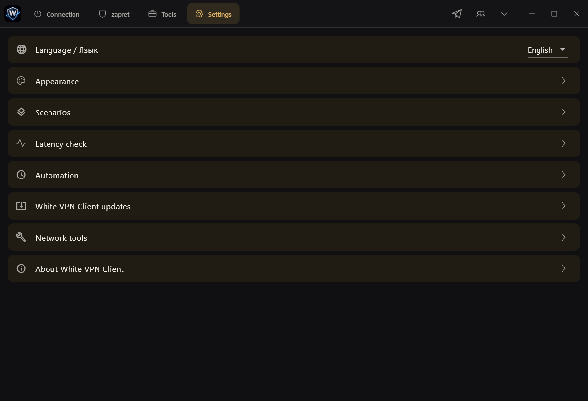](docs/screenshots/en/language.png)

More English screenshots

### Appearance

[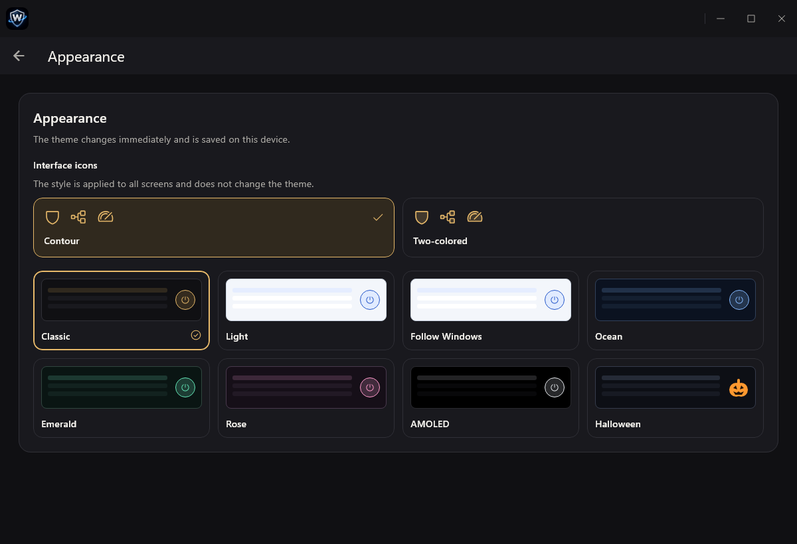](docs/screenshots/en/appearance.png)

### First connection

[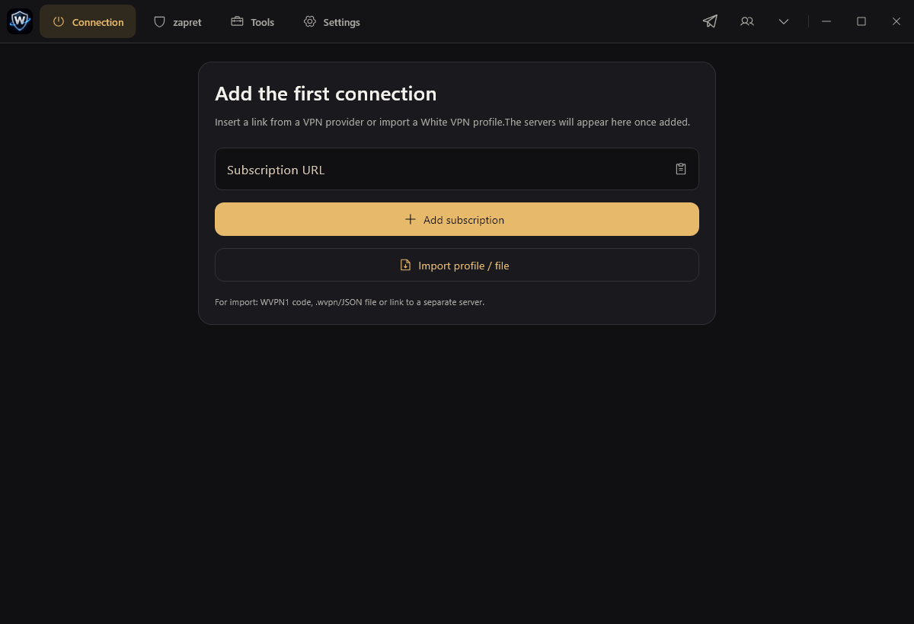](docs/screenshots/en/first-connection.png)

### Profiles and transfers

[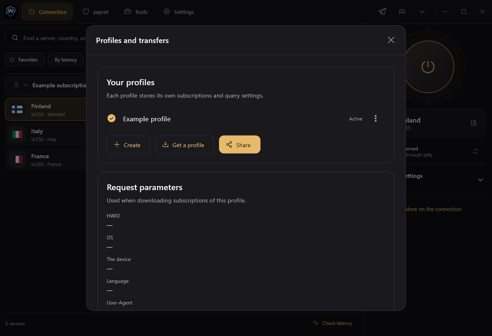](docs/screenshots/en/profiles.png)

### zapret

[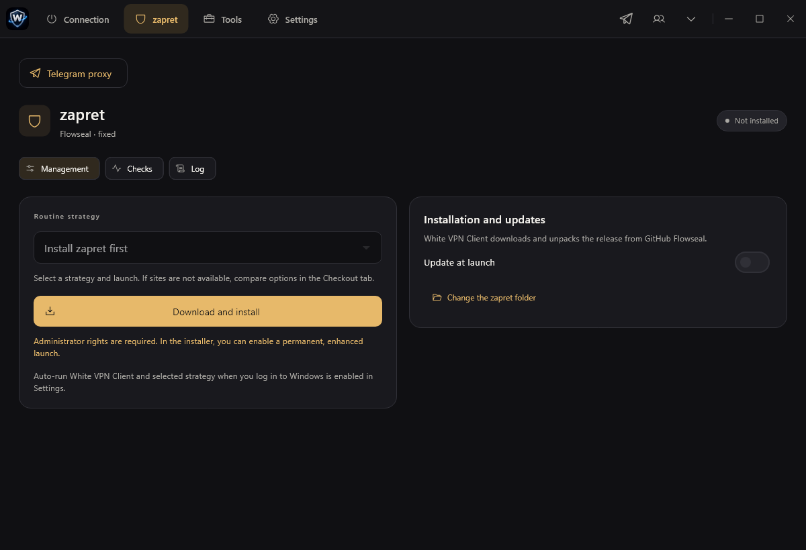](docs/screenshots/en/zapret.png)

### App updates

[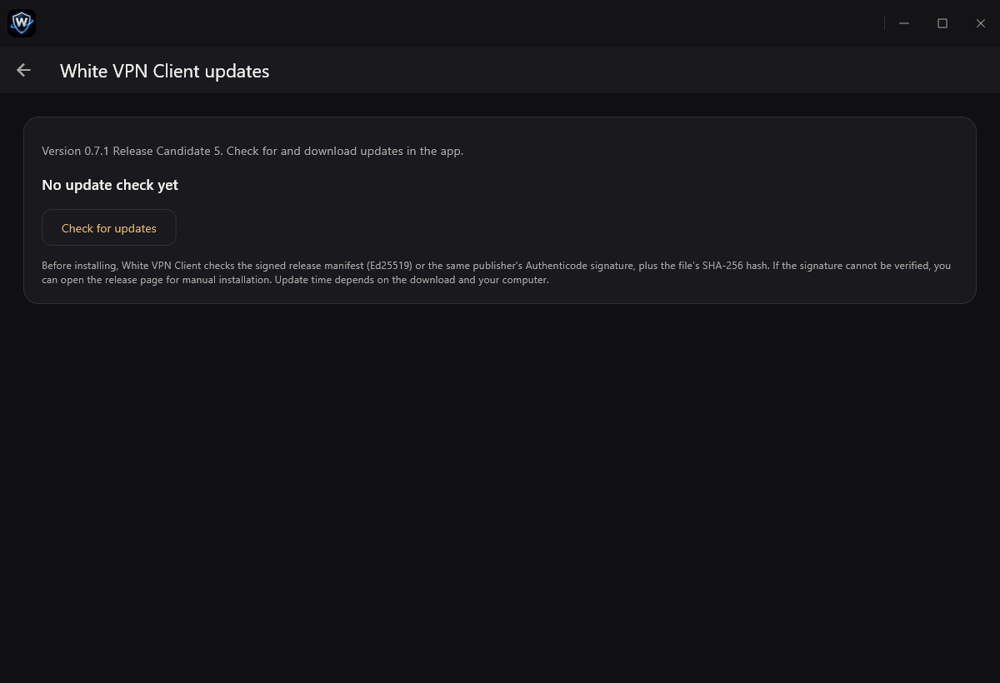](docs/screenshots/en/updates.png)

### Selecting servers for a speed comparison

[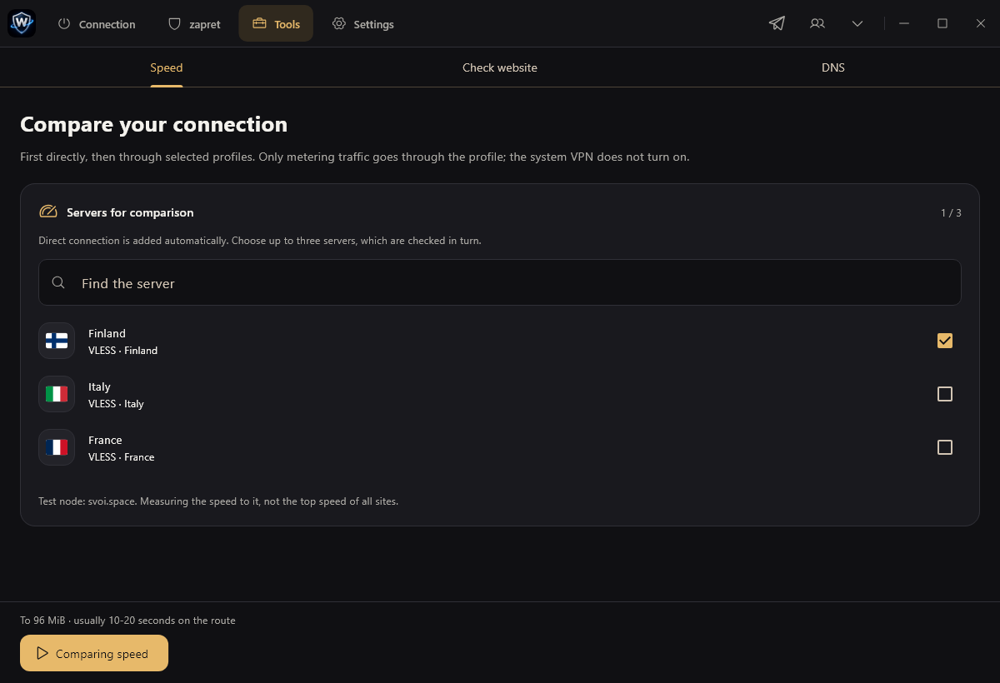](docs/screenshots/en/speed-test.png)

[Russian screenshots from the previous preview](docs/screenshots).

## Android screenshots

Server selection, the language menu, and appearance settings in White VPN Client 0.1.0. Select an image to open it at full size.

<a href="docs/screenshots/android/en/servers.jpg">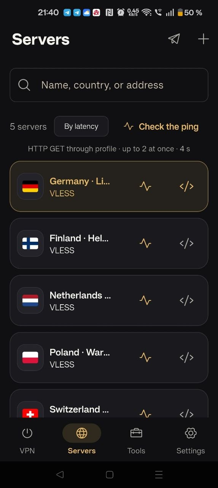</a>
<a href="docs/screenshots/android/en/language.jpg">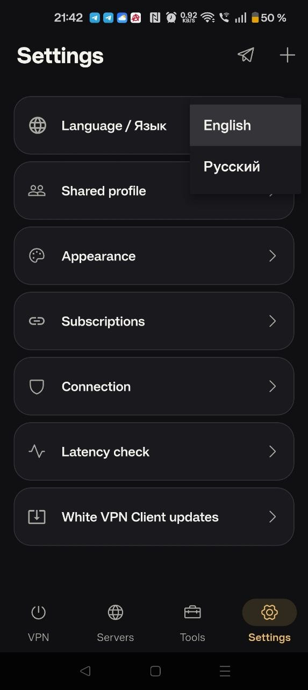</a>
<a href="docs/screenshots/android/en/appearance.jpg">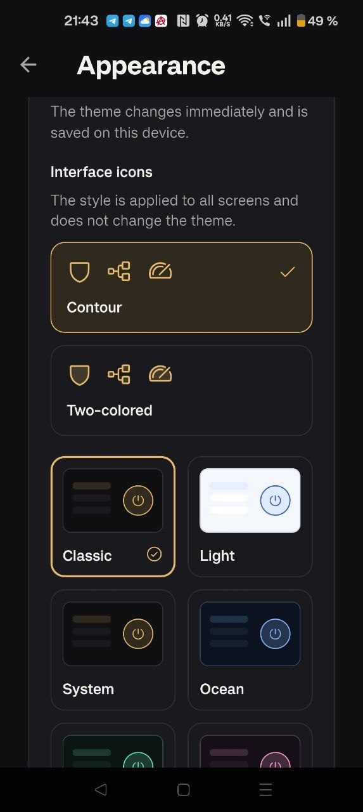</a>

## Credits

White VPN Client is based on [SVOI](https://github.com/1atex/svoi), distributed under the [MIT license](https://github.com/1atex/svoi/blob/main/LICENSE).

