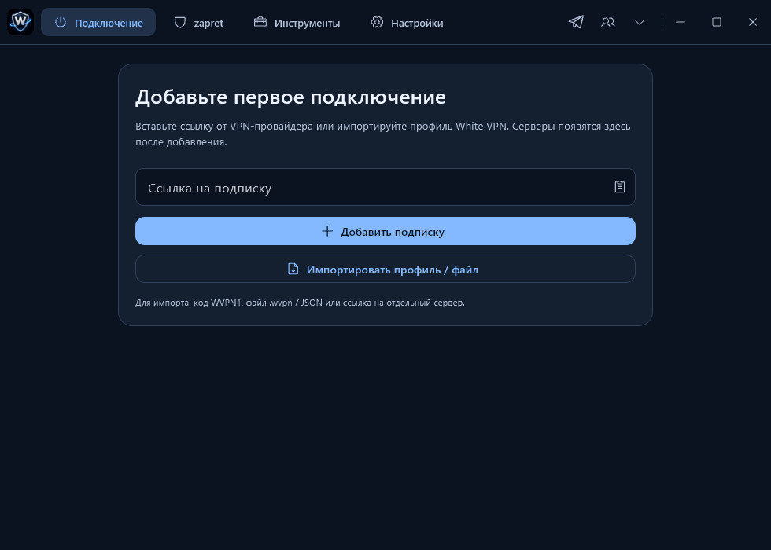
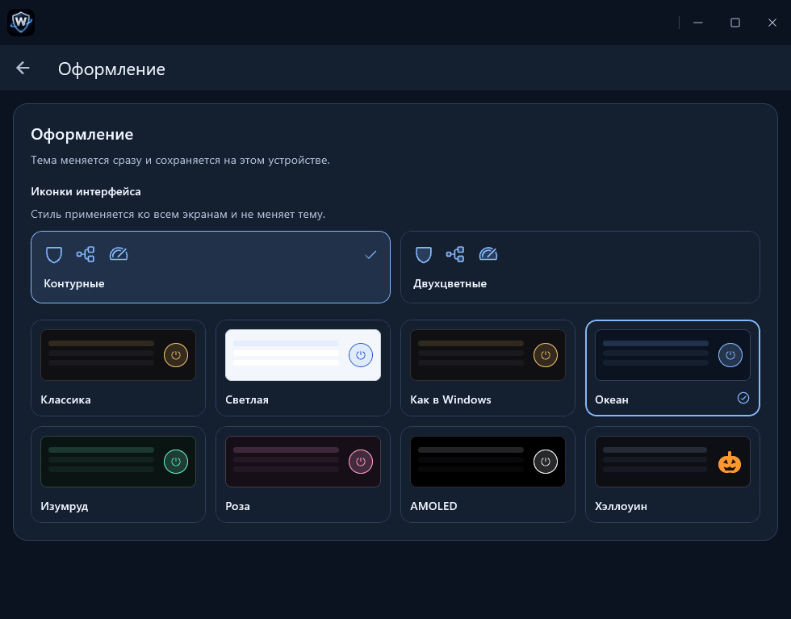
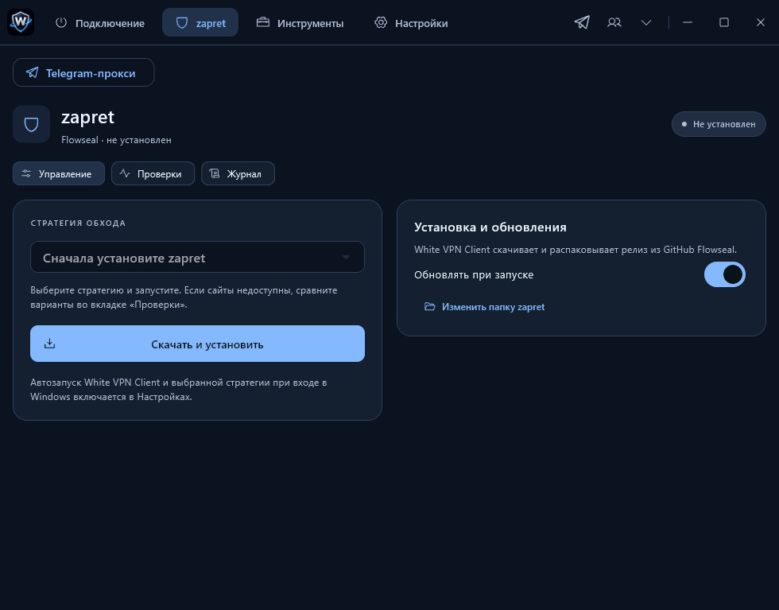
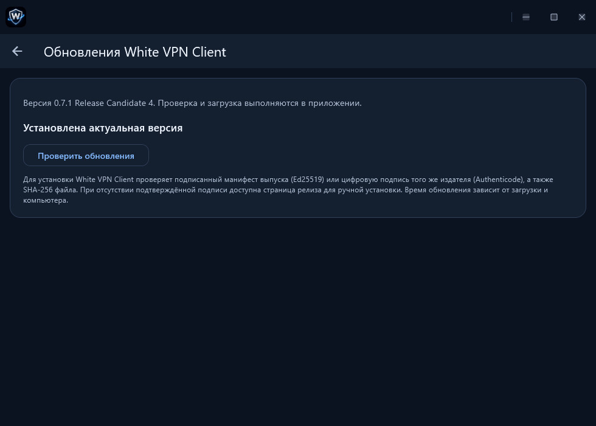
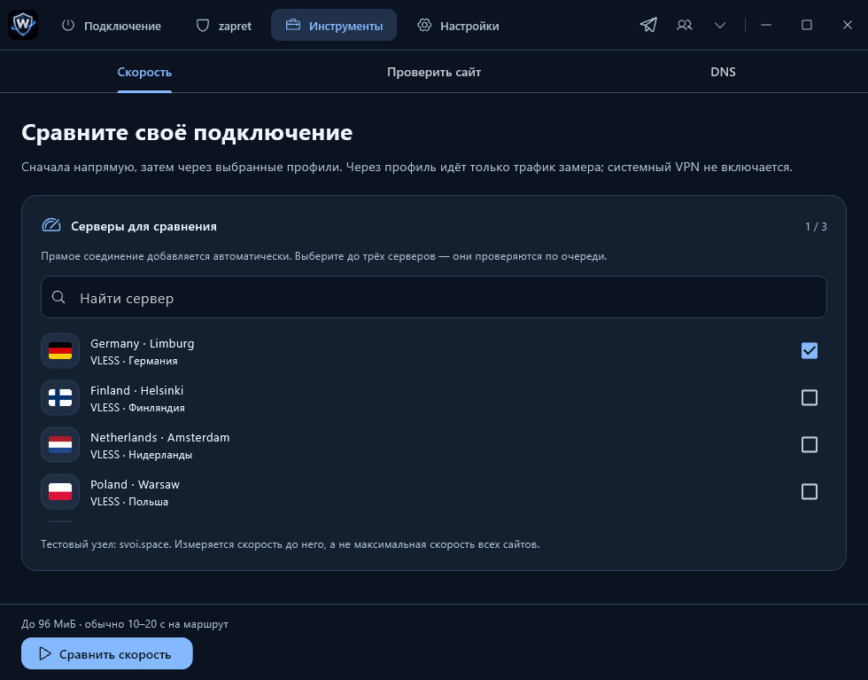

# White VPN Client

Official releases of White VPN Client. The Windows preview supports Windows 10 and 11 (x64).

[Download the Windows preview](https://github.com/Shuravi89/whitevpn-client-releases/releases/tag/v0.7.1-rc.4) · [All releases](https://github.com/Shuravi89/whitevpn-client-releases/releases) · [Official website](https://white-vpn.net/en/)

## White VPN Client для Windows

Добавьте совместимую VPN-подписку, выберите сервер и подключитесь. В приложении можно проверять задержку и сохранять серверы в избранное. На странице предварительного релиза доступны установщик Windows и портативный ZIP.

## Скриншоты / Screenshots

На скриншотах показан русский интерфейс предварительной версии. Нажмите на изображение, чтобы открыть оригинал.

### Первое подключение / First connection

### Оформление / Appearance

Ещё скриншоты — zapret, обновления и выбор серверов для замера

### zapret

### Обновления

### Выбор серверов для сравнения скорости

## Благодарности / Credits

White VPN Client is based on [SVOI](https://github.com/1atex/svoi), distributed under the [MIT license](https://github.com/1atex/svoi/blob/main/LICENSE).
