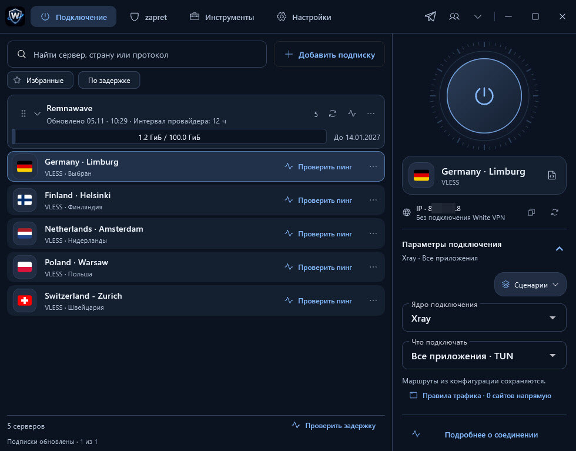
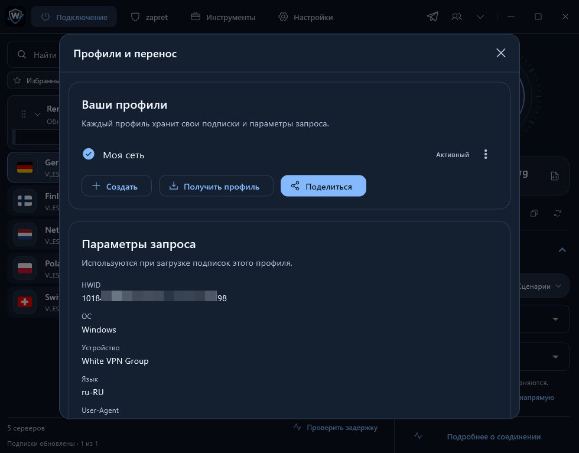

# White VPN Client

Official releases of White VPN Client. The Windows preview supports Windows 10 and 11 (x64).

[Download the Windows preview](https://github.com/Shuravi89/whitevpn-client-releases/releases/tag/v0.7.1-rc.4) · [All releases](https://github.com/Shuravi89/whitevpn-client-releases/releases) · [Official website](https://white-vpn.net/en/)

## White VPN Client for Windows

Add a compatible VPN subscription, choose a server, and connect. You can check latency and save favorite servers in the app. The preview release includes a Windows installer and a portable ZIP.

## Screenshots

The screenshots show the preview's Russian interface. Select an image to open it at full size.

### Connection and server selection

### Appearance

More screenshots

### First connection

### Profiles and transfer

### zapret

### App updates

### Selecting servers for a speed comparison

## Credits

White VPN Client is based on [SVOI](https://github.com/1atex/svoi), distributed under the [MIT license](https://github.com/1atex/svoi/blob/main/LICENSE).
